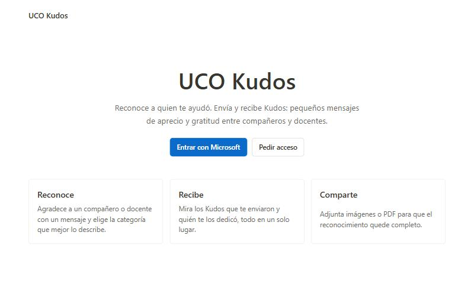
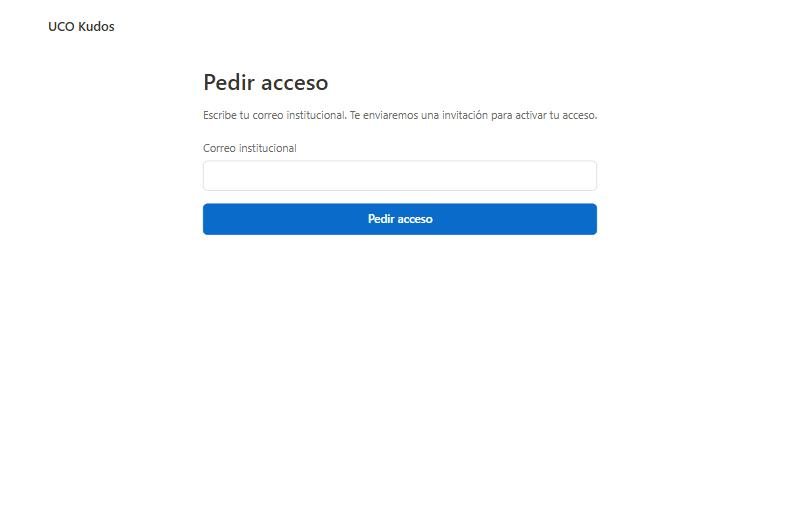
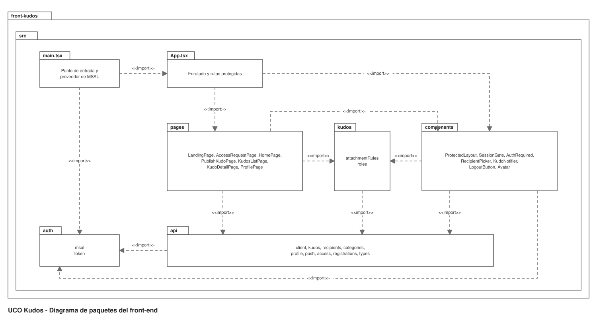

# front-kudos

Interfaz web de UCO Kudos: React, TypeScript y Vite, pensada primero para móvil.

- **Sitio publicado:** https://kudos.ucokudos.qd.je
- **API:** repositorio [UcoKudos](https://github.com/Andruortiz/UcoKudos), con la arquitectura completa del sistema.

## Pantallas

Las dos pantallas públicas.

<p>
  
  
</p>

Con sesión iniciada: **Inicio**, **Recibidos**, **Enviados**, **Enviar** (con adjuntos, que se pueden quitar antes de enviar), **detalle de un Kudo** (con descarga de adjuntos) y **Perfil**, donde se registra y verifica el celular con un código por SMS. Sin el celular verificado no se pueden enviar Kudos.

## Estructura



Las páginas conocen la API solo a través del paquete `api`. El diagrama también está como archivo [editable](docs/imagenes/diagrama-de-paquetes-front.drawio) para [diagrams.net](https://app.diagrams.net).

## Comandos

```bash
npm install
npm run dev
npm test
npm run build
```

## Configuración

Copiar `.env.example` a `.env` y ajustar `VITE_API_URL` con la dirección del back-end.

Para iniciar sesión con Microsoft Entra define también `VITE_ENTRA_TENANT_ID` y `VITE_ENTRA_CLIENT_ID`. Sin ellos la aplicación corre sin login y usa `VITE_DEV_USER_ID`, que solo se envía en desarrollo.

## Despliegue

Cada push a `master` ejecuta `.github/workflows/ci-cd.yml`: instala, revisa el código, corre las pruebas, escanea con Trivy, compila y publica en Azure Static Web Apps. Los pull requests solo ejecutan las comprobaciones.

- El secreto `AZURE_STATIC_WEB_APPS_API_TOKEN` debe existir en los secretos del repositorio.
- Las variables `VITE_*` de producción están en el propio workflow, porque Vite las incrusta al compilar. No son secretos.
- `public/staticwebapp.config.json` hace que un enlace directo como `/kudos/abc` abra la aplicación y no un 404.
- Al cambiar de dirección el backend o el sitio, se actualizan `VITE_API_URL` y `SITE_URL` en el workflow, y hay que agregar la dirección nueva como URI de redirección SPA en Microsoft Entra.
